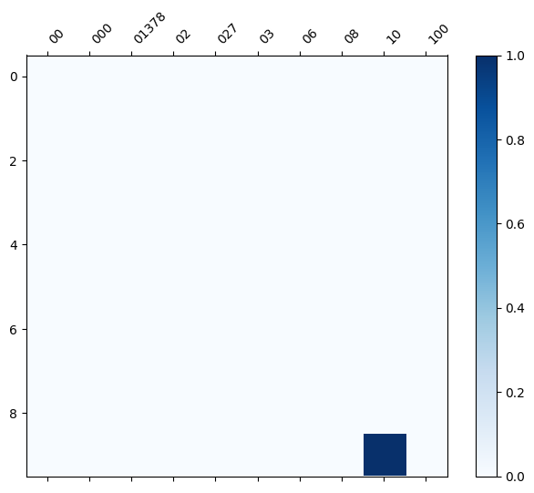

# Homework Analysis Report

**Author:** Hu Chia Yu  
**Student ID:** G1154191001  
**Date:** October 10, 2026  

---

## 1. Executive Summary

This homework report documents the extension of the custom text-mining tool pipeline to a new target domain dataset: `newdataset/Reddit-stock-sentiment.csv`. The workflow was executed interactively through the agentic chat environment, validating tool portability across non-newsgroup, short-form social media text structures.

---

## 2. Experimental Pipeline & Findings

### Step 1: Dataset Ingestion (`load_dataset_tool`)
- **Result ID:** `load_dataset_1`
- **Dataset Path:** `newdataset/Reddit-stock-sentiment.csv`
- **Configuration:** `text_column="text"`, `label_column="label"`
- **Findings:** Ingested 847 documents across three sentiment classes: neutral (`0.0`: 423), negative (`-1.0`: 315), and positive (`1.0`: 109).

### Step 2: DTM Matrix Construction (`build_dtm_tool`)
- **Result ID:** `build_dtm_1`
- **Findings:** Built document-term matrix containing 4,346 unique terms and 17,193 non-zero entries (Matrix Capacity: 3,681,062). Sparsity was measured at **99.53%**, reflecting the compact and sparse nature of short social media text.

### Step 3: Term Frequency Distribution (`term_frequency_tool`)
- **Result ID:** `term_frequency_1`
- **Findings:** Extracted top 20 terms across Reddit financial discussions. Top frequencies include unstopped English structural words: `the` (920), `to` (566), `and` (488), `is` (402), and `it` (350).

### Step 4: Sub-matrix Heatmap Slice (`dtm_heatmap_tool`)
- **Result ID:** `dtm_heatmap_1`
- **Findings & Visualization:** Generated a 10x10 document-by-term matrix slice visualization saved to `plots/`, illustrating sparse local term distribution.

---

## 3. Comparative Discussion & Conclusion

1. **Tool Generalizability:** The custom tools (`build_dtm_tool`, `term_frequency_tool`, `dtm_heatmap_tool`) executed seamlessly on short financial social media text without parameter mismatch errors, verifying the robustness of Pydantic schemas and `RecordAdapter` integration.
2. **Batch Gate Authorization:** The agent successfully triggered single-batch authorization for student tools upon user consent, confirming "Gate 27" security compliance.
